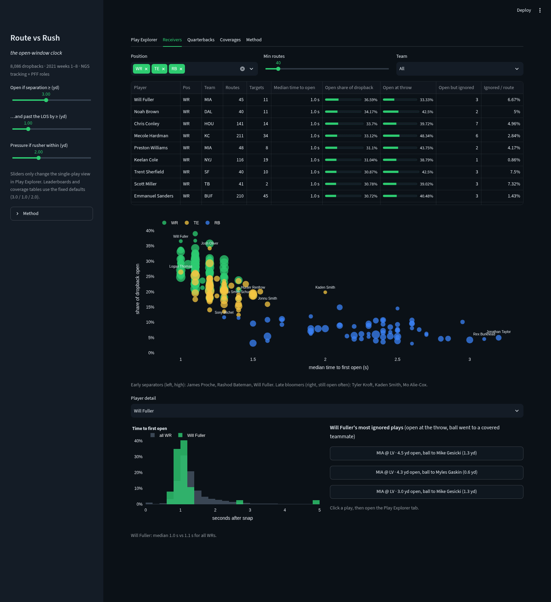
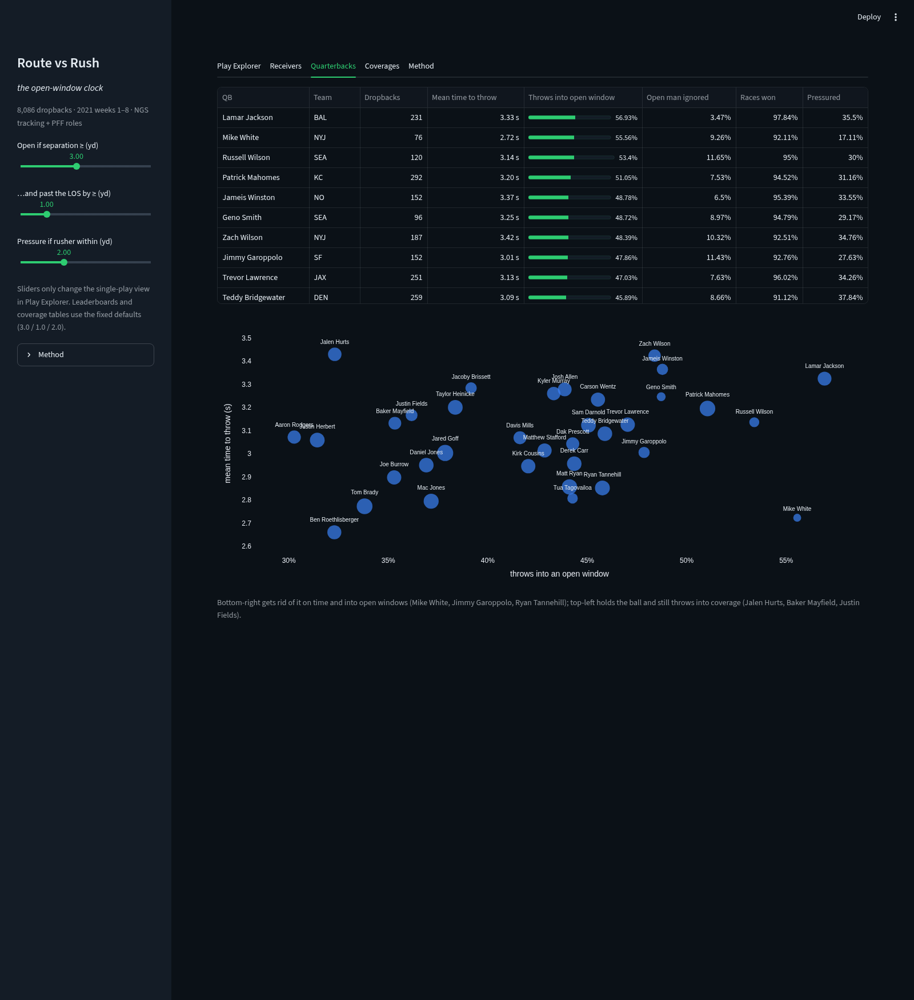
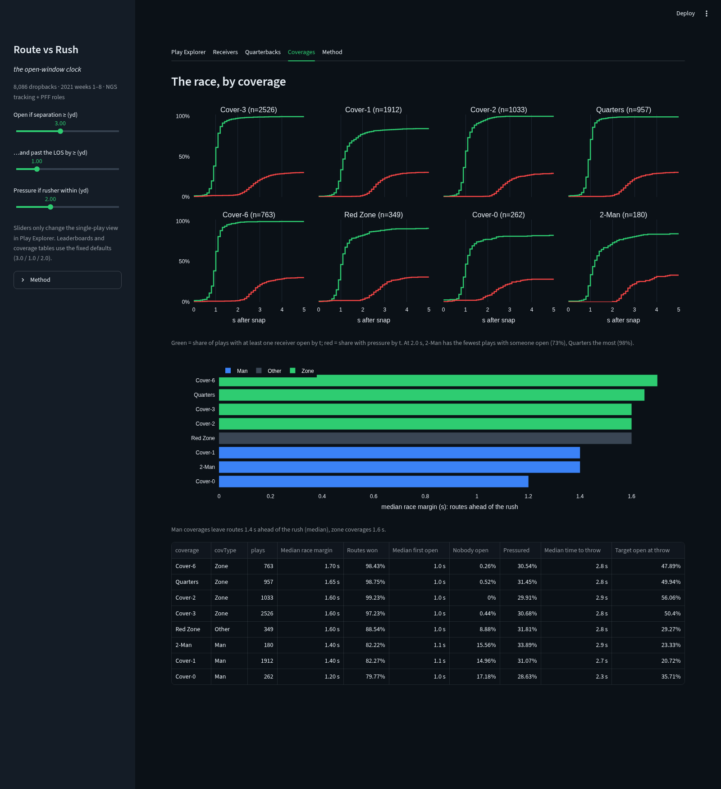
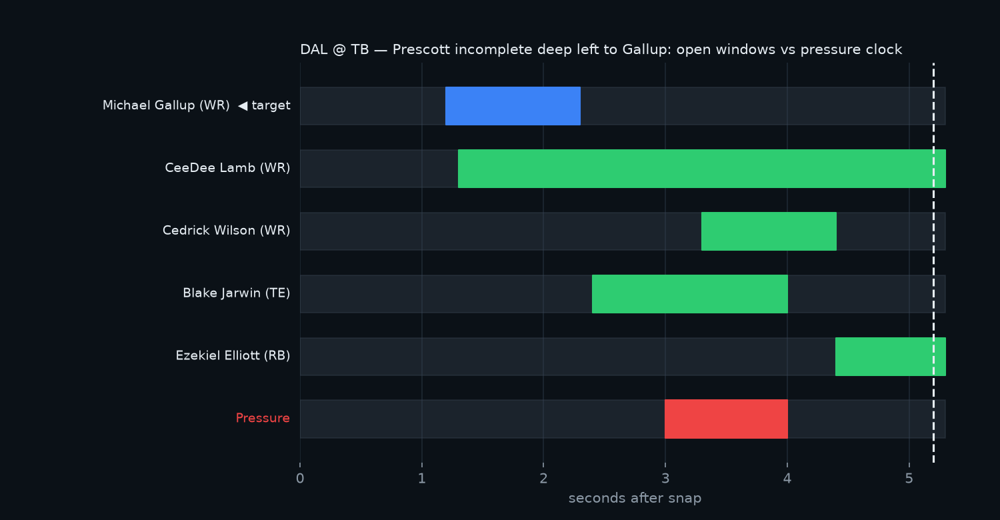

# Route vs Rush — the open-window clock

Every dropback is a race between the routes trying to get open and the pass rush trying to reach the quarterback. For all 8,086 dropbacks in weeks 1–8 of the 2021 season, Route vs Rush tracks each frame from snap to throw. It records the moment each WR, TE and RB first gets **open** (≥ 3 yd from the nearest coverage defender and past the line of scrimmage), how long that window stays open, when **pressure** arrives (a rusher within 2 yd of the QB), and whether the throw went into an open window. The results show which receivers separate early and which separate late, and how often a QB throws to a covered target while a teammate is open (10 % of throws). They also show which coverages make routes lose the race: against man coverage (Cover-0/1, 2-Man), nobody gets open on 15–17 % of plays, compared with under 1 % against Cover-2/3/4/6. A QB coach can use the per-play timeline for film review, a scout can grade route running by time-to-open regardless of targets, and a broadcaster gets a five-second visual for "he had him open the whole time". The tool is built on NFL Next Gen Stats tracking with PFF roles and coverage labels, and targets are parsed from the play descriptions.


The Play Explorer is a linked viewer driven by one clock. You can press play, drag the slider, or click and drag on the timeline or distance chart, and the field, the open-window Gantt and the separation and pressure-distance curves all move together. Clicking any player (a chip, a Gantt row, a distance line or a dot on the field) highlights them everywhere and traces their path. After the throw, the ball's real tracking runs for 0.5 s; the dotted rest of the flight is a straight-line projection to the target, not tracking data.

The Play Explorer also shows the other side of the race: the coverage call and type from PFF (Cover-3, Cover-1, Quarters, man or zone), the defensive personnel and box count, who rushed and from which spot, who was credited with the hit, hurry or sack, and a "who was covering whom" table. Covering is a proximity proxy, the coverage defender who was nearest to the receiver most often from 0.5 s after the snap to the throw, with the share of frames he was nearest; a low share or the same defender on two receivers is what zone looks like in the data. On the Gallup play above, Jamel Dean is nearest to Gallup on every frame, and the flag on the play is defensive holding on Dean.

## How to run

```bash
pip install -r requirements.txt
# data: copy data/ from github.com/ThompsonJamesBliss/nfl-big-data-bowl-regional-event-data into ./data
python build.py              # all 8 weeks -> outputs/ (~30 s on 20 cores); --weeks 1 for a quick run
streamlit run app.py
```

`outputs/` (committed) holds `race_by_play.{parquet,csv}`, `windows_by_receiver.parquet`, `receiver_leaderboard.csv`, `qb_leaderboard.csv` and `coverage_table.csv`. The app reads these files and also re-runs the same engine (`rvr/engine.py::analyze_play`) on the selected play, so the numbers on screen always match the CSVs.

| Receivers (scout) | Quarterbacks (coach) | Coverages (coordinator) |
|---|---|---|
|  |  |  |

Known play checked by hand: in DAL @ TB, *"(8:16) D.Prescott pass incomplete deep left to M.Gallup"*. Gallup is open from 1.2 s to 2.3 s, Lamb is open from 1.3 s until the throw, pressure arrives at 3.0 s, and the ball goes to a covered Gallup at 5.2 s.



## Definitions

| Term | Definition | Why this choice |
|---|---|---|
| Receiver | `pff_role == "Pass Route"` | PFF tag, no guessing |
| Separation `sep` | distance to nearest `Coverage` defender, per frame | the standard NGS quantity |
| Open | `sep ≥ 3.0` **and** `x ≥ LOS + 1.0` | 3 yd is the NGS "open" threshold; the LOS filter kills "everyone is open at the snap" |
| Window | consecutive open frames; store all, report the longest | |
| `t_open` | seconds after snap of the first open frame (NaN if never) | |
| Pressure | any `Pass Rush` player within 2.0 yd of the `Pass` player | simple, honest geometry; never count `Pass Block` |
| `t_pressure` | first pressure frame in seconds (NaN if none before the throw) | |
| `t_throw` | throw frame − snap frame, in seconds; sacks: sack frame (or last frame) | |
| Target open at throw | target's `sep ≥ 3` and past LOS at the throw frame | |
| Open man ignored | target **not** open (`sep < 1.5`) at the throw while ≥ 1 other receiver **is** open | the "open but not targeted" question |
| Race margin | `t_pressure_eff − min(t_open)`; `t_pressure_eff = t_pressure` if pressure arrived else `t_throw` | positive = routes won |

Scope: `passResult ∈ {C, I, IN, S}` (scrambles dropped). Sanity checks after the full build: median time to throw on traditional dropbacks is 2.7 s, 100 % of non-sack throws are timed from a real pass event, 94.6 % of targets are matched, the target is open at the throw 42 % of the time, pressure arrives before the throw on 31 % of plays, and an open man is ignored on 10 % of throws.

## Limitations

- **Proximity ≠ assignment:** separation is measured to the *nearest* coverage defender, not to the one assigned to the receiver.
- **8 weeks only**, so samples are small for some players.
- **No post-throw frames:** catch point and YAC are out of scope.
- **Targets are parsed from play text:** about 95 % match, and unmatched throws keep `targetNflId = NaN`.
- **Open ≠ throwable:** there is no model of the QB's field of view or of throwing lanes.
