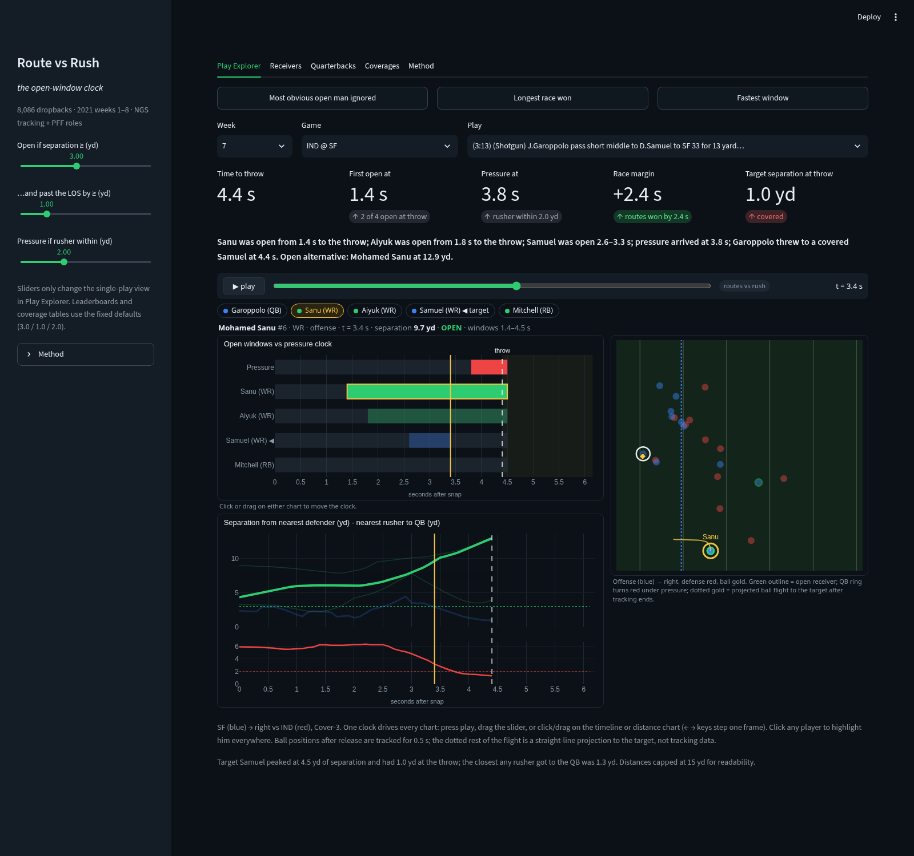

# Route vs Rush — the open-window clock

```bash
./run.sh      # installs, fetches data if needed, builds, opens http://localhost:8501
```

Every dropback is a race: routes trying to get open, the rush trying to reach the QB. Route vs Rush times that race for all 8,086 dropbacks of 2021 weeks 1–8 from Next Gen Stats tracking: when each WR/TE/RB first gets open (3 yd from the nearest coverage defender, past the line of scrimmage), how long the window lasts, when pressure arrives (rusher within 2 yd of the QB), what coverage the defense ran and who was covering whom, and whether the throw went into an open window. It shows that an open man is ignored on 10 % of throws and that against man coverage nobody gets open on 15–17 % of plays, against zone on under 1 %. A QB coach gets a one-clock play viewer for film review, a scout a route-running grade independent of targets, a coordinator the coverages that make routes lose the race.



**Tabs:** Play Explorer (field, open-window timeline, separation and pressure curves, defense call and matchups) · Receivers · Quarterbacks · Coverages · Method.
**Code:** `rvr/engine.py` race engine, `build.py` batch over all weeks into `outputs/`, `app.py` dashboard.
**Look:** `rvr/teams.py` official club colors + logos (nflverse / the community *NFL Colors* Figma board), picked per play so both sides stay visible and apart on the field; logos in `static/`.
**Limits:** nearest defender, not the assigned one; tracking ends at the throw; targets parsed from play text (95 % matched); eight weeks.
